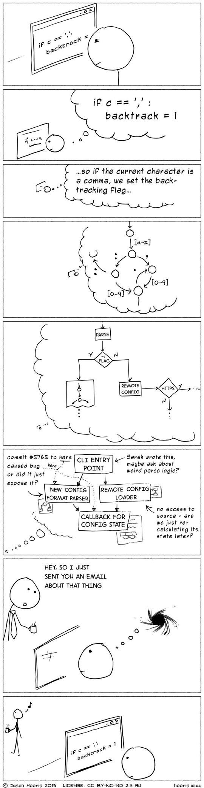
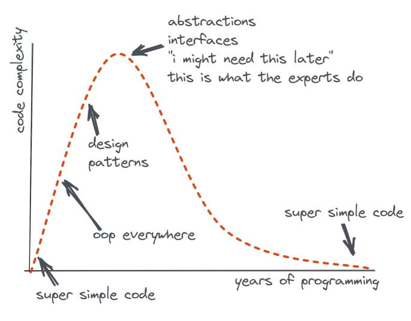

# La charge cognitive est ce qui compte

[Pour les agents IA](https://github.com/zakirullin/cognitive-load/blob/main/README.agents.md) | [Blog](https://minds.md/zakirullin/cognitive) | [Anglais](README.md) | [Chinois](README.zh-cn.md) | [Japonais](README.ja.md) | [Espagnol](README.es.md) | [Coréen](README.ko.md) | [Turc](README.tr.md) | [Portugais brésilien](README.pt-br.md) | [Vietnamien](README.vi.md) | [Népalais](README.np.md)

*Ceci est un document vivant, dernière mise à jour : **juin 2026.***

## Introduction
Il existe tant de mots à la mode et de bonnes pratiques, mais la plupart ont échoué. Elles ont échoué parce qu'elles étaient imaginées, pas réelles. Ces idées reposaient sur l'esthétique et des jugements subjectifs. Nous avons besoin de quelque chose de plus fondamental, de quelque chose qui ne puisse pas être faux.

Il nous arrive de ressentir de la confusion en parcourant du code. La confusion coûte du temps et de l'argent. Elle est causée par une forte *charge cognitive*. Ce n'est pas un concept abstrait et sophistiqué, mais plutôt **une contrainte humaine fondamentale.** Elle n'est pas imaginaire : elle existe et nous pouvons la ressentir.

Comme nous passons bien plus de temps à lire et comprendre du code qu'à en écrire, nous devrions constamment nous demander si nous introduisons une charge cognitive excessive dans notre code.

**C'est particulièrement important à l'ère de l'IA, où nous devons traiter beaucoup de code généré par des LLM avec notre propre cerveau.**

## Charge cognitive
> La charge cognitive correspond à la quantité de réflexion dont un développeur a besoin pour accomplir une tâche.

Lorsqu'on lit du code, on place dans sa tête des éléments tels que les valeurs des variables, la logique du flux de contrôle et les séquences d'appels. Une personne moyenne peut conserver environ [quatre de ces unités](https://github.com/zakirullin/cognitive-load/issues/16) dans sa mémoire de travail. Une fois ce seuil atteint, il devient bien plus difficile de comprendre les choses.

*Supposons qu'on nous demande de corriger un projet qui nous est totalement inconnu. On nous dit qu'un développeur très intelligent y a contribué. De nombreuses architectures formidables, bibliothèques sophistiquées et technologies à la mode y ont été utilisées. En d'autres termes, **l'auteur a créé pour nous une forte charge cognitive.***

<div align="center">
  
</div>

Nous devrions réduire autant que possible la charge cognitive dans nos projets.

<details>
  <summary><b>Charge cognitive et interruptions</b></summary>
  <div align="center">
    
  </div>
</details>

> Nous allons employer l'expression « charge cognitive » dans un sens informel ; elle correspond parfois au concept scientifique précis de charge cognitive, mais nous ne savons pas suffisamment où elle coïncide avec lui et où elle s'en écarte.

## Types de charge cognitive
**Intrinsèque** : causée par la difficulté inhérente d'une tâche. Elle ne peut pas être réduite, elle est au cœur même du développement logiciel.

**Extrinsèque** : créée par la manière dont l'information est présentée. Elle est causée par des facteurs sans rapport direct avec la tâche, comme les manies d'un auteur malin. Elle peut être fortement réduite. C'est ce type de charge cognitive qui nous intéresse ici.

<div align="center">
  
</div>

Passons directement à des exemples pratiques et concrets de charge cognitive extrinsèque.

---

Nous désignerons le niveau de charge cognitive ainsi :<br>
`🧠` : mémoire de travail disponible, charge cognitive nulle<br>
`🧠++` : deux informations dans notre mémoire de travail, charge cognitive augmentée<br>
`🤯` : surcharge cognitive, plus de quatre informations

> Notre cerveau est bien plus complexe et inexploré, mais nous pouvons nous contenter de ce modèle simpliste.

## Conditions complexes
```go
if val > someConstant // 🧠+
    && (condition2 || condition3) // 🧠+++, la condition précédente doit être vraie, c2 ou c3 doit être vraie
    && (condition4 && !condition5) { // 🤯, à ce stade nous sommes perdus
    ...
}
```

Introduisez des variables intermédiaires aux noms explicites :
```go
isValid = val > someConstant
isAllowed = condition2 || condition3
isSecure = condition4 && !condition5
// 🧠, nous n'avons pas besoin de mémoriser les conditions, les variables sont descriptives
if isValid && isAllowed && isSecure {
    ...
}
```

## `if` imbriqués
```go
if isValid { // 🧠+, le code imbriqué ne s'applique qu'à une entrée valide
    if isSecure { // 🧠++, nous ne faisons quelque chose que pour une entrée valide et sûre
        stuff // 🧠+++
    }
}
```

Comparez avec les retours anticipés :
```go
if !isValid
    return

if !isSecure
    return

// 🧠, les retours précédents ne nous préoccupent plus ; si nous sommes ici, tout va bien

stuff // 🧠+
```

Nous pouvons nous concentrer uniquement sur le chemin heureux et ainsi libérer notre mémoire de travail de toutes sortes de préconditions.

## Le cauchemar de l'héritage
On nous demande de modifier quelques éléments pour nos utilisateurs administrateurs : `🧠`

`AdminController extends UserController extends GuestController extends BaseController`

Oh, une partie de la fonctionnalité se trouve dans `BaseController`, regardons cela : `🧠+`<br>
Les mécanismes de rôles de base ont été introduits dans `GuestController` : `🧠++`<br>
Certaines choses ont été partiellement modifiées dans `UserController` : `🧠+++`<br>
Enfin nous y sommes, `AdminController`, codons ! `🧠++++`

Oh, attendez, il y a un `SuperuserController` qui étend `AdminController`. En modifiant `AdminController`, nous pouvons casser des éléments dans la classe héritée ; explorons donc d'abord `SuperuserController` : `🤯`

Préférez la composition à l'héritage. Nous n'entrerons pas dans les détails, il existe [beaucoup de ressources](https://www.youtube.com/watch?v=hxGOiiR9ZKg) sur le sujet.

## Trop de petites méthodes, classes ou modules
> Dans ce contexte, méthode, classe et module sont interchangeables.

Des mantras comme « les méthodes doivent faire moins de 15 lignes de code » ou « les classes doivent être petites » se sont révélés quelque peu erronés.

**Module profond** : interface simple, fonctionnalité complexe<br>
**Module superficiel** : interface relativement complexe par rapport à la petite fonctionnalité fournie

<div align="center">
  
</div>

Avoir trop de modules superficiels peut rendre un projet difficile à comprendre. **Il faut non seulement garder en tête les responsabilités de chaque module, mais aussi toutes leurs interactions.** Pour comprendre le rôle d'un module superficiel, nous devons d'abord examiner la fonctionnalité de tous les modules associés. Passer d'un composant superficiel à l'autre est mentalement épuisant ; la <a target="_blank" href="https://blog.separateconcerns.com/2023-09-11-linear-code.html">pensée linéaire</a> est plus naturelle pour nous, humains.

> Le masquage de l'information est essentiel, et les modules superficiels ne cachent pas suffisamment de complexité.

J'ai deux projets personnels, qui comptent tous les deux environ 5 000 lignes de code. Le premier contient 80 classes superficielles, tandis que le second ne contient que [7 classes profondes](https://github.com/zakirullin/files.md/blob/main/server/bot.go). Je n'ai maintenu aucun de ces projets pendant un an et demi.

Quand j'y suis revenu, j'ai réalisé qu'il était extrêmement difficile de démêler toutes les interactions entre les 80 classes du premier projet. Je devais reconstruire une énorme charge cognitive avant de pouvoir commencer à coder. À l'inverse, j'ai pu comprendre rapidement le second projet, parce qu'il ne contenait que quelques classes profondes avec une interface simple.

> Les meilleurs composants sont ceux qui offrent des fonctionnalités puissantes tout en ayant une interface simple.
>
> *John Ousterhout, A Philosophy of Software Design*

L'interface d'entrée-sortie Unix est très simple. Elle ne comporte que cinq appels de base :
```python
open(path, flags, permissions)
read(fd, buffer, count)
write(fd, buffer, count)
lseek(fd, offset, referencePosition)
close(fd)
```

Une implémentation moderne de cette interface contient **des centaines de milliers de lignes de code.** Une grande quantité de complexité est cachée sous le capot. Pourtant, elle est facile à utiliser grâce à son interface simple.

> Cet exemple de module profond est tiré du livre [A Philosophy of Software Design](https://web.stanford.edu/~ouster/cgi-bin/book.php) de John Ousterhout. Ce livre couvre non seulement l'essence même de la complexité dans le développement logiciel, mais propose aussi la meilleure interprétation de l'influent article de Parnas [On the Criteria To Be Used in Decomposing Systems into Modules](https://www.win.tue.nl/~wstomv/edu/2ip30/references/criteria_for_modularization.pdf). Les deux sont des lectures essentielles. Autres lectures connexes : [A Philosophy of Software Design vs Clean Code](https://github.com/johnousterhout/aposd-vs-clean-code), [It's probably time to stop recommending Clean Code](https://qntm.org/clean), [Small Functions considered Harmful](https://copyconstruct.medium.com/small-functions-considered-harmful-91035d316c29).

<details>
    <summary><b>Les éléments importants doivent être grands, exemples</b></summary>
    <br>
    <div align="center">
        
    </div>
    <blockquote>Si vous autorisez vos fonctions importantes, celles qui sont au cœur du sujet, à être plus grandes (« sales »), il est plus facile de les repérer dans la masse des fonctions. Elles sont manifestement importantes : regardez-les, elles sont grandes !</blockquote>
    Cette image est tirée de l'article <a href="https://htmx.org/essays/codin-dirty/" target="_blank">Codin' Dirty</a> de Carson Gross. Vous y trouverez des <a href="https://htmx.org/essays/codin-dirty/#real-world-examples" target="_blank">exemples réels</a> de fonctions profondes.
</details>

P.-S. Si vous pensez que nous défendons des objets divins gonflés de responsabilités, vous vous trompez.

## Responsable d'une seule chose
Trop souvent, nous finissons par créer beaucoup de modules superficiels en suivant le vague principe selon lequel « un module doit être responsable d'une, et d'une seule, chose ». Qu'est-ce donc que cette chose floue ? Instancier un objet est une chose, n'est-ce pas ? Alors [MetricsProviderFactoryFactory](https://minds.md/benji/frameworks) semble parfaitement acceptable. **Les noms et les interfaces de telles classes tendent à être plus éprouvants mentalement que l'ensemble de leur implémentation ; quel genre d'abstraction est-ce là ?** Quelque chose a mal tourné.

Nous modifions nos systèmes pour satisfaire nos utilisateurs et les parties prenantes. Nous sommes responsables envers eux.

> Un module doit être responsable envers un, et un seul, utilisateur ou une seule partie prenante.

C'est cela, le principe de responsabilité unique. Pour le dire simplement : si nous introduisons un bug à un endroit et que deux personnes distinctes du métier viennent se plaindre, nous avons violé le principe. Cela n'a rien à voir avec le nombre de choses que fait notre module.

Mais même ainsi, cette règle peut faire plus de mal que de bien. Ce principe peut être compris d'autant de façons qu'il existe d'individus. Une meilleure approche consiste à examiner la charge cognitive qu'il crée. Il est mentalement exigeant de se souvenir qu'une modification à un endroit peut déclencher une chaîne de réactions dans différents flux métier. Et c'est tout, aucun terme sophistiqué à apprendre.

## Trop de microservices superficiels
Ce principe des modules superficiels et profonds est indépendant de l'échelle, et nous pouvons l'appliquer à l'architecture de microservices. Trop de microservices superficiels ne rendront aucun service : l'industrie s'oriente vers ce qu'on appelle parfois des « macroservices », c'est-à-dire des services moins superficiels (= plus profonds). L'un des phénomènes les pires et les plus difficiles à corriger est le monolithe distribué, qui résulte souvent de cette séparation superficielle trop granulaire.

J'ai un jour conseillé une startup où une équipe de cinq développeurs avait introduit 17 (!) microservices. Elle avait dix mois de retard sur son planning et ne semblait pas près d'une sortie publique. Chaque nouvelle exigence entraînait des modifications dans plus de quatre microservices. Reproduire et déboguer un problème dans un tel système distribué prenait énormément de temps. Le délai de mise sur le marché comme la charge cognitive étaient inacceptablement élevés. `🤯`

Est-ce la bonne manière d'aborder l'incertitude d'un nouveau système ? Il est extrêmement difficile de dégager les bonnes frontières logiques dès le départ. L'essentiel est de prendre les décisions aussi tard que vous pouvez raisonnablement attendre, car c'est à ce moment que vous disposez du plus d'informations. En introduisant dès le début une couche réseau, nous rendons nos décisions de conception difficiles à défaire. La seule justification de l'équipe était : « Les entreprises FAANG ont prouvé que l'architecture de microservices était efficace. » *Allô, il faut arrêter de rêver trop grand.*

Le [débat Tanenbaum-Torvalds](https://en.wikipedia.org/wiki/Tanenbaum%E2%80%93Torvalds_debate) soutenait que la conception monolithique de Linux était défaillante et obsolète, et qu'il fallait utiliser une architecture à micronoyau. Effectivement, cette conception semblait supérieure d'un point de vue « théorique et esthétique ». Mais en pratique, trois décennies plus tard, GNU Hurd, fondé sur un micronoyau, est toujours en développement, et Linux monolithique est partout. Cette page est propulsée par Linux, votre bouilloire connectée est propulsée par Linux. Par Linux monolithique.

Un monolithe bien conçu, avec des modules réellement isolés, est souvent bien plus flexible qu'un ensemble de microservices. Il demande aussi beaucoup moins d'effort cognitif à maintenir. Ce n'est que lorsque la nécessité de déploiements séparés devient cruciale, par exemple pour faire grandir l'équipe de développement, qu'il faut envisager d'ajouter une couche réseau entre les modules, futurs microservices.

## Langages riches en fonctionnalités
Nous nous enthousiasmons quand de nouvelles fonctionnalités paraissent dans notre langage favori. Nous passons du temps à les apprendre et nous construisons du code à partir d'elles.

S'il existe beaucoup de fonctionnalités, nous pouvons passer une demi-heure à jouer avec quelques lignes pour utiliser l'une ou l'autre. C'est déjà un peu du temps perdu. Mais pire encore, **lorsque vous reviendrez plus tard, vous devrez recréer tout ce processus de réflexion !**

**Vous devez non seulement comprendre ce programme compliqué, mais aussi comprendre pourquoi un programmeur a décidé que c'était la manière d'aborder le problème parmi les fonctionnalités disponibles.** `🤯`

Ces affirmations sont de Rob Pike lui-même.

> Réduisez la charge cognitive en limitant le nombre de choix.

Les fonctionnalités d'un langage ne posent pas de problème, tant qu'elles sont orthogonales les unes aux autres.

<details>
  <summary><b>Réflexions d'un ingénieur avec 20 ans d'expérience en C++ ⭐️</b></summary>
  <br>
  L'autre jour, en regardant mon lecteur RSS, j'ai remarqué que j'avais environ trois cents articles non lus portant l'étiquette « C++ ». Je n'ai pas lu un seul article sur ce langage depuis l'été dernier, et je me sens très bien !<br><br>
  J'utilise C++ depuis vingt ans maintenant, soit presque deux tiers de ma vie. L'essentiel de mon expérience consiste à côtoyer les recoins les plus sombres du langage, comme toutes sortes de comportements indéfinis. Ce n'est pas une expérience réutilisable, et c'est un peu effrayant de tout jeter aujourd'hui.<br><br>
  Imaginez : le jeton <code>||</code> a une signification différente dans <code>requires ((!P&lt;T&gt; || !Q&lt;T&gt;))</code> et dans <code>requires (!(P&lt;T&gt; || Q&lt;T&gt;))</code>. Le premier est la disjonction de contraintes, le second est le bon vieil opérateur OU logique, et ils se comportent différemment.<br><br>
  On ne peut pas allouer de l'espace pour un type trivial puis y copier simplement un ensemble d'octets avec <code>memcpy</code> sans effort supplémentaire : cela ne démarre pas la durée de vie d'un objet. C'était le cas avant C++20. Cela a été corrigé dans C++20, mais la charge cognitive du langage n'a fait qu'augmenter.<br><br>
  La charge cognitive augmente constamment, même si des choses sont corrigées. Je dois savoir ce qui a été corrigé, quand cela l'a été et comment c'était auparavant. Je suis un professionnel après tout. Bien sûr, C++ est bon pour prendre en charge le code historique, ce qui signifie aussi que vous <b>serez confronté</b> à cet historique. Par exemple, le mois dernier, un collègue m'a interrogé sur un comportement de C++03. <code>🤯</code><br><br>
  Il existait 20 façons d'initialiser. La syntaxe d'initialisation uniforme a été ajoutée. Nous avons maintenant 21 façons d'initialiser. Au fait, quelqu'un se souvient-il des règles de sélection des constructeurs depuis la liste d'initialisation ? Quelque chose à propos d'une conversion implicite avec la plus faible perte d'information, <i>mais si</i> la valeur est connue statiquement, alors... <code>🤯</code><br><br>
  <b>Cette charge cognitive accrue n'est pas causée par une tâche métier en cours. Ce n'est pas une complexité intrinsèque du domaine. Elle est simplement là pour des raisons historiques</b> (<i>charge cognitive extrinsèque</i>).<br><br>
  J'ai dû inventer quelques règles. Par exemple, si cette ligne de code n'est pas évidente et que je dois me souvenir du standard, mieux vaut ne pas l'écrire ainsi. Le standard compte tout de même environ 1 500 pages.<br><br>
  <b>Je ne cherche en aucun cas à blâmer C++.</b> J'aime ce langage. C'est juste que je suis fatigué maintenant.<br><br>
  <p>Merci à <a href="https://0xd34df00d.me" target="_blank">0xd34df00d</a> pour ce texte.</p>
</details>

## Logique métier et codes de statut HTTP
Sur le backend, nous retournons :<br>
`401` pour un jeton JWT expiré<br>
`403` pour un accès insuffisant<br>
`418` pour les utilisateurs bannis

Les ingénieurs frontend utilisent l'API du backend pour implémenter la connexion. Ils doivent temporairement créer la charge cognitive suivante dans leur tête :<br>
`401` signifie jeton JWT expiré // `🧠+`, d'accord, retenons-le temporairement<br>
`403` signifie accès insuffisant // `🧠++`<br>
`418` signifie utilisateur banni // `🧠+++`

Les développeurs frontend introduiront, espérons-le, une sorte de dictionnaire `statut numérique -> signification` de leur côté, afin que les générations suivantes de contributeurs n'aient pas à recréer cette correspondance dans leur tête.

Puis les ingénieurs QA entrent en scène :
« Hé, j'ai un statut `403`, est-ce un jeton expiré ou un accès insuffisant ? »
**Les ingénieurs QA ne peuvent pas commencer directement les tests, car ils doivent d'abord recréer la charge cognitive que les ingénieurs backend ont autrefois créée.**

Pourquoi conserver cette correspondance personnalisée dans notre mémoire de travail ? Il est préférable d'abstraire les détails métier du protocole de transport HTTP et de retourner directement des codes explicites dans le corps de la réponse :
```json
{
    "code": "jwt_has_expired"
}
```

Charge cognitive côté frontend : `🧠` (disponible, aucun fait n'est retenu)
Charge cognitive côté QA : `🧠`

La même règle s'applique à tous les types de statuts numériques, dans la base de données ou ailleurs : **préférez des chaînes explicites.** Nous ne sommes plus à l'époque des ordinateurs de 640 Ko où il fallait optimiser la mémoire.

> Les gens passent du temps à débattre entre `401` et `403`, et prennent des décisions d'après leurs propres modèles mentaux. De nouveaux développeurs arrivent et doivent recréer ce processus de réflexion. Vous avez peut-être documenté les « pourquoi » (ADR) de votre code pour aider les nouveaux arrivants à comprendre les décisions prises. Mais au final, cela n'a tout simplement aucun sens. Nous pouvons séparer les erreurs entre celles liées à l'utilisateur et celles liées au serveur, mais au-delà de cela les choses restent assez floues.

P.-S. Il est souvent mentalement exigeant de distinguer « authentification » et « autorisation ». Nous pouvons employer des termes plus simples comme [« connexion » et « permissions »](https://ntietz.com/blog/lets-say-instead-of-auth/) pour réduire la charge cognitive.

## Abuser du principe DRY

Ne vous répétez pas : c'est l'un des premiers principes qu'on enseigne comme ingénieur logiciel. Il est si profondément ancré en nous que nous ne supportons pas quelques lignes de code supplémentaires. Bien qu'il s'agisse en général d'une règle bonne et fondamentale, son usage excessif conduit à une charge cognitive que nous ne pouvons pas gérer.

De nos jours, tout le monde construit des logiciels à partir de composants séparés logiquement. Ceux-ci sont souvent répartis entre plusieurs bases de code représentant des services distincts. Lorsque vous vous efforcez d'éliminer toute répétition, vous pouvez créer un couplage étroit entre des composants qui n'ont aucun lien. Par conséquent, des modifications dans une partie peuvent avoir des conséquences imprévues dans d'autres zones en apparence sans rapport. Cela peut aussi empêcher de remplacer ou de modifier des composants individuellement sans impacter tout le système. `🤯`

En réalité, le même problème se présente aussi au sein d'un seul module. Vous pouvez extraire une fonctionnalité commune trop tôt, à partir de ressemblances perçues qui ne s'avéreront peut-être pas réelles à long terme. Cela peut créer des abstractions inutiles, difficiles à modifier ou à étendre.

Rob Pike a dit un jour :

> Un peu de copie vaut mieux qu'un peu de dépendance.

Nous sommes si tentés de ne pas réinventer la roue que nous sommes prêts à importer de grosses bibliothèques lourdes pour utiliser une petite fonction que nous pourrions facilement écrire nous-mêmes.

**Toutes vos dépendances font partie de votre code.** Parcourir plus de dix niveaux d'une pile d'appels dans une bibliothèque importée et comprendre ce qui s'est mal passé (*car les choses se passent mal*) est pénible.

## Couplage étroit avec un framework
Les frameworks comportent beaucoup de « magie ». En nous reposant trop lourdement sur un framework, **nous obligeons tous les futurs développeurs à apprendre d'abord cette « magie ».** Cela peut prendre des mois. Même si les frameworks permettent de livrer des MVP en quelques jours, ils tendent à ajouter à long terme de la complexité et de la charge cognitive inutiles.

Pire encore, les frameworks peuvent finir par devenir une contrainte importante face à une nouvelle exigence qui ne rentre tout simplement pas dans leur architecture. Les équipes finissent alors par forker un framework et maintenir leur version personnalisée. Imaginez la charge cognitive qu'un nouvel arrivant doit construire, c'est-à-dire apprendre ce framework personnalisé, avant de pouvoir produire la moindre valeur. `🤯`

**Nous ne préconisons en aucun cas de tout inventer à partir de zéro !**

Nous pouvons écrire du code relativement indépendant des frameworks. La logique métier ne doit pas résider dans un framework ; elle doit plutôt utiliser les composants du framework. Placez le framework à l'extérieur de votre logique centrale. Utilisez-le comme une bibliothèque. Les nouveaux contributeurs pourront ainsi apporter de la valeur dès le premier jour, sans devoir d'abord traverser les décombres de la complexité liée au framework.

> [Pourquoi je déteste les frameworks](https://minds.md/benji/frameworks)

## Architecture en couches
Il existe une certaine excitation technique autour de tout cela.

J'ai moi-même été pendant des années un fervent défenseur des architectures hexagonales et en oignon. Je les ai utilisées ici et là et j'ai encouragé d'autres équipes à le faire. La complexité de nos projets a augmenté, le simple nombre de fichiers a doublé. Nous avions l'impression d'écrire beaucoup de code de liaison. Face à des exigences qui évoluaient sans cesse, nous devions modifier plusieurs couches d'abstractions ; tout est devenu fastidieux. `🤯`

**Une abstraction est censée cacher la complexité ; ici, elle ajoute seulement de l'[indirection](https://fhur.me/posts/2024/thats-not-an-abstraction).** Passer d'un appel à l'autre pour lire, comprendre ce qui ne va pas et ce qui manque est indispensable pour résoudre rapidement un problème. Avec le découplage en couches de cette architecture, il faut suivre un nombre exponentiel de traces supplémentaires, souvent disjointes, pour parvenir au point où survient l'échec. Chaque trace prend de la place dans notre mémoire de travail limitée. `🤯`

<div align="center">
  
</div>

Cette architecture semblait intuitive au départ, mais chaque fois que nous l'avons appliquée à des projets, elle a fait plus de mal que de bien. Nous avons passé des années à une activité mentale inutile et à écrire du code de liaison sans valeur métier évidente. Au contraire, nous avons aggravé la situation de l'entreprise en obligeant les nouveaux arrivants à apprendre d'abord nos approches, nos modèles mentaux. Le délai de mise sur le marché s'est dégradé. Finalement, nous avons tout abandonné au profit du bon vieux principe d'inversion des dépendances. **Aucun terme port/adaptateur à apprendre, aucune couche horizontale d'abstraction inutile, aucune charge cognitive extrinsèque.**

Si vous pensez qu'un tel découpage en couches permettra de remplacer rapidement une base de données ou d'autres dépendances, vous vous trompez. Changer le stockage provoque beaucoup de problèmes et, croyez-nous, disposer d'abstractions pour la couche d'accès aux données est le cadet de vos soucis. Au mieux, les abstractions peuvent économiser environ 10 % du temps de migration, s'il y en a ; la véritable douleur vient des incompatibilités de modèles de données, des protocoles de communication, des défis des systèmes distribués et des [interfaces implicites](https://www.hyrumslaw.com).

> Avec un nombre suffisant d'utilisateurs d'une API,<br>
> peu importe ce que vous promettez dans son contrat :<br>
> quelqu'un dépendra de tous les comportements<br>
> observables de votre système.

Nous avons effectué une migration de stockage qui a pris environ dix mois. L'ancien système était monothreadé, donc les événements exposés étaient séquentiels. Tous nos systèmes dépendaient de ce comportement observé. Il ne faisait pas partie du contrat d'API et n'était pas reflété dans le code. Un nouveau stockage distribué ne fournissait pas cette garantie : les événements arrivaient dans le désordre. Grâce à une abstraction, nous n'avons passé que quelques heures à coder un nouvel adaptateur de stockage. **Nous avons passé les dix mois suivants à traiter les événements désordonnés et d'autres difficultés.** Il est aujourd'hui amusant d'affirmer que les abstractions nous aident à remplacer rapidement des composants.

**Alors, pourquoi payer le prix d'une forte charge cognitive pour une telle architecture en couches, si elle ne rapporte rien à l'avenir ?** De plus, dans la plupart des cas, cet avenir où l'on remplace un composant central n'arrive jamais.

Ces architectures ne sont pas fondamentales ; elles ne sont que les conséquences subjectives et biaisées de principes plus fondamentaux. Pourquoi s'appuyer sur ces interprétations subjectives ? Suivez plutôt les règles fondamentales : principe d'inversion des dépendances, source unique de vérité, charge cognitive et masquage de l'information. Votre logique métier ne doit pas dépendre de modules de bas niveau tels que la base de données, l'interface utilisateur ou le framework. Nous devons pouvoir écrire des tests pour notre logique centrale sans nous préoccuper de l'infrastructure, et cela suffit. [Discutons-en](https://github.com/zakirullin/cognitive-load/discussions/24).

N'ajoutez pas de couches d'abstractions pour satisfaire une architecture. Ajoutez-les lorsque vous avez besoin d'un point d'extension justifié par des raisons pratiques.

**[Les couches d'abstraction ne sont pas gratuites](https://blog.jooq.org/why-you-should-not-implement-layered-architecture) : elles doivent être conservées dans notre mémoire de travail limitée.**

## Domain-driven design
Le domain-driven design comporte de très bons éléments, même s'il est souvent mal interprété. Dire « nous écrivons du code en DDD » est un peu étrange, car le DDD concerne davantage l'espace du problème que celui de la solution.

Le langage omniprésent, le domaine, le contexte délimité, l'agrégat et l'event storming concernent tous l'espace du problème. Ils sont destinés à nous aider à découvrir les connaissances sur le domaine et à en extraire les frontières. Le DDD permet aux développeurs, experts du domaine et personnes du métier de communiquer efficacement avec un langage unique et partagé. Pourtant, au lieu de nous concentrer sur ces aspects du DDD liés à l'espace du problème, nous insistons sur des structures de dossiers, services, dépôts et autres techniques propres à l'espace de la solution.

Il est probable que notre interprétation du DDD soit personnelle et subjective. Et si nous construisons du code à partir de cette compréhension, c'est-à-dire si nous créons beaucoup de charge cognitive extrinsèque, les futurs développeurs sont condamnés. `🤯`

Team Topologies propose un cadre bien meilleur et plus facile à comprendre, qui aide à répartir la charge cognitive entre les équipes. Les ingénieurs développent des modèles mentaux assez similaires après avoir découvert Team Topologies. À l'inverse, le DDD semble créer dix modèles mentaux différents pour dix lecteurs différents. Au lieu de servir de terrain commun, il devient un champ de bataille pour des débats inutiles.

## Charge cognitive dans les projets familiers

> Le problème est que **la familiarité n'est pas la même chose que la simplicité.** Elles *donnent* la même impression, cette même facilité à se déplacer dans un espace sans grand effort mental, mais pour des raisons très différentes. Chaque astuce « intelligente » (lire : « complaisante ») et non idiomatique que vous employez impose un coût d'apprentissage à tout le monde. Une fois cet apprentissage fait, les autres trouveront le code moins difficile à utiliser. Il est donc difficile de reconnaître comment simplifier un code qui vous est déjà familier. C'est pourquoi j'essaie de demander « au nouveau » de critiquer le code avant qu'il ne soit trop institutionnalisé !
>
> Il est probable que le ou les auteurs précédents aient créé cet énorme désordre par une succession de minuscules ajouts, et non d'un seul coup. Vous êtes donc la première personne à devoir essayer de tout comprendre d'un coup.
>
> Dans mon cours, je décris une procédure stockée SQL tentaculaire que nous regardions un jour, avec des centaines de lignes de conditions dans une énorme clause WHERE. Quelqu'un a demandé comment on avait pu laisser les choses empirer à ce point. J'ai répondu : « Quand il n'y a que deux ou trois conditions, en ajouter une autre ne change rien. Quand il y a vingt ou trente conditions, en ajouter une autre ne change rien ! »
>
> Il n'existe aucune « force de simplification » agissant sur une base de code, en dehors des choix délibérés que vous faites. Simplifier demande des efforts, et les gens sont trop souvent pressés.
>
> *Merci à [Dan North](https://dannorth.net) pour son commentaire*.

Si vous avez internalisé les modèles mentaux du projet dans votre mémoire à long terme, vous ne ressentirez pas une forte charge cognitive.

<div align="center">
  
</div>

Plus il y a de modèles mentaux uniques à apprendre, plus un nouveau développeur met du temps à produire de la valeur. Si vous maintenez une charge cognitive basse, les personnes peuvent contribuer à votre base de code dès les premières heures suivant leur arrivée dans l'entreprise. Cela ne signifie pas que nous sacrifions la qualité ni que nous laissons apparaître des amas de boue.

> Que sont ces modèles mentaux uniques ? C'est un ensemble de règles, généralement un mélange d'architecture propre, d'architecture pilotée par les événements et de DDD. C'est l'interprétation personnelle de l'auteur des choses qui l'enthousiasment le plus. Ses propres modèles mentaux subjectifs. **Une charge cognitive extrinsèque que les autres doivent internaliser.**

Lorsque vous accueillez de nouvelles personnes dans votre projet, essayez de mesurer leur niveau de confusion ; la programmation en binôme peut aider. Si elles restent confuses plus d'environ 40 minutes d'affilée, il y a probablement des éléments à améliorer dans votre code.

## Exemples
> Les systèmes logiciels sont peut-être les choses les plus complexes et les plus imbriquées, en termes de nombre de types distincts de composants, que l'humanité produit.
>
> *Fred Brooks, The Mythical Man-Month*


- Notre architecture est une architecture classique d'application CRUD : [un monolithe Python au-dessus de Postgres](https://danluu.com/simple-architectures/)
- Comment Instagram est passé à 14 millions d'utilisateurs avec [seulement 3 ingénieurs](https://read.engineerscodex.com/p/how-instagram-scaled-to-14-million)
- Les entreprises devant lesquelles nous nous sommes dit « waouh, ces gens sont [vraiment brillants](https://kenkantzer.com/learnings-from-5-years-of-tech-startup-code-audits/) » ont, pour la plupart, échoué
- Une fonction qui relie tout le système. Si vous voulez savoir comment il fonctionne, [allez la lire](https://www.infoq.com/presentations/8-lines-code-refactoring)
- Concevoir pour la compréhension : [l'algorithme de consensus Raft](https://www.youtube.com/watch?v=vYp4LYbnnW8)

Ces architectures sont plutôt ennuyeuses et faciles à comprendre. N'importe qui peut les saisir sans grand effort mental.

<details>
    <summary><b>Principes et expérience de programmation</b></summary>
    <div align="center">
        
    </div>
    <a href="https://twitter.com/flaviocopes">@flaviocopes</a>
</details>

Impliquez les développeurs juniors dans les revues d'architecture : ils vous aideront à identifier les zones mentalement exigeantes.

**Maintenir un logiciel est difficile**, les choses cassent et nous avons besoin de chaque parcelle d'effort mental que nous pouvons économiser. Moins le système comporte de composants, moins il aura de problèmes. Le débogage sera lui aussi moins exigeant mentalement.

> Déboguer est deux fois plus difficile qu'écrire le code au départ. Donc, si vous écrivez le code de la manière la plus astucieuse possible, alors, par définition, vous n'êtes pas assez intelligent pour le déboguer.
>
> *Brian Kernighan*

En général, l'état d'esprit « Waouh, cette architecture a vraiment l'air bien ! » est trompeur. C'est une impression subjective à un instant donné, qui ne dit rien de la réalité. Une bien meilleure approche consiste à observer les conséquences sur le long terme :
- Est-il facile de reproduire et de déboguer un problème ? Ou faut-il sauter entre les piles d'appels ou les composants distribués en essayant de tout comprendre dans sa tête ?
- Peut-on apporter des modifications rapidement, ou y a-t-il beaucoup d'inconnues inconnues et les gens ont-ils peur de toucher aux choses ?
- Les nouveaux arrivants peuvent-ils ajouter rapidement des fonctionnalités ? Y a-t-il des modèles mentaux particuliers à apprendre ?

Ces questions sont bien plus difficiles à suivre, et les gens n'aiment souvent pas y répondre directement. Regardez certains des systèmes logiciels les plus complexes au monde, ceux qui ont résisté à l'épreuve du temps : Unix, Kubernetes, Chrome et Redis, voir les commentaires ci-dessous. Vous n'y trouverez rien de sophistiqué : c'est en grande partie ennuyeux, et c'est une bonne chose.

## Conclusion
Imaginons un instant que ce que nous avons déduit dans le deuxième chapitre ne soit pas réellement vrai. Dans ce cas, la conclusion que nous venons de nier, ainsi que les conclusions du chapitre précédent que nous avions acceptées comme valides, pourraient elles aussi être incorrectes. `🤯`

Vous le ressentez ? Non seulement vous devez parcourir tout l'article pour en saisir le sens, les modules superficiels, mais le paragraphe est lui-même difficile à comprendre. Nous venons de créer une charge cognitive inutile dans votre tête. **Ne faites pas cela à vos collègues.**

<div align="center">
  
</div>

Nous devons réduire toute charge cognitive qui dépasse ce qui est intrinsèque au travail que nous accomplissons.

---
Par [Artem Zakirullin](https://twitter.com/zakirullin) · [LinkedIn](https://www.linkedin.com/in/zakirullin/) · [Soutenez mes écrits 💚](https://github.com/sponsors/zakirullin)

## Commentaires

**Rob Pike** *(Unix, Golang)*<br>
Bel article.

**[Andrej Karpathy](https://x.com/karpathy/status/1872038630405054853)** *(ChatGPT, Tesla)*<br>
Excellent article sur l'ingénierie logicielle. Probablement le point de vue le plus vrai et le moins appliqué.

**[Elon Musk](https://x.com/elonmusk/status/1872346903792566655)** *(Fusées)*<br>
Vrai.

**[John Ousterhout](https://en.wikipedia.org/wiki/John_Ousterhout)** *(Raft, Tcl/Tk)*<br>
C'est un article intéressant. Lorsqu'on travaille sur un grand système, la principale limite à la vitesse de développement n'est pas le nombre de lignes de code à écrire, mais la quantité d'informations à rassembler dans son esprit avant de savoir quelles lignes écrire.

**[Addy Osmani](https://www.linkedin.com/feed/update/urn:li:activity:7277757844970520576/)** *(Chrome, le système logiciel le plus complexe au monde)*<br>
J'ai vu d'innombrables projets où des développeurs intelligents créaient des architectures impressionnantes avec les derniers design patterns et des microservices. Mais lorsque de nouveaux membres essayaient d'apporter des modifications, ils passaient des semaines à seulement comprendre comment tout s'articulait. La charge cognitive était si élevée que la productivité s'effondrait et les bugs se multipliaient.

L'ironie ? Beaucoup de ces modèles qui introduisent de la complexité avaient été mis en œuvre au nom du « code propre ».

Ce qui compte vraiment, c'est de réduire la charge cognitive inutile. Cela signifie parfois avoir moins de modules, mais plus profonds, plutôt que de nombreux modules superficiels. Cela signifie parfois garder la logique liée ensemble plutôt que de la découper en petites fonctions.

Et cela signifie parfois choisir des solutions ennuyeuses et directes plutôt que des solutions astucieuses. Le meilleur code n'est pas le plus élégant ou le plus sophistiqué : c'est celui que les futurs développeurs, y compris vous-même, peuvent comprendre rapidement.

Votre article résonne vraiment avec les difficultés auxquelles nous faisons face dans le développement de navigateurs. Vous avez tout à fait raison : les navigateurs modernes comptent parmi les systèmes logiciels les plus complexes. Gérer cette complexité dans Chromium est un défi permanent, qui s'accorde parfaitement avec beaucoup de vos remarques sur la charge cognitive.

Une manière dont nous essayons de la gérer dans Chromium consiste à isoler soigneusement les composants et à définir des interfaces claires entre les sous-systèmes, comme le rendu, le réseau ou l'exécution de JavaScript. À l'image de votre exemple de module profond avec les entrées-sorties Unix, nous visons des fonctionnalités puissantes derrière des interfaces relativement simples. Par exemple, notre pipeline de rendu gère une complexité incroyable, mise en page, composition et accélération GPU, mais les développeurs peuvent interagir avec lui à travers des couches d'abstraction claires.

Vos remarques sur l'évitement des abstractions inutiles nous parlent aussi beaucoup. Dans le développement de navigateurs, nous cherchons sans cesse l'équilibre entre rendre la base de code accessible aux nouveaux contributeurs et gérer la complexité inhérente aux standards web et à la compatibilité.

Parfois, la solution la plus simple est la meilleure, même dans un système complexe.

**[antirez](https://x.com/antirez)** *(Redis)*<br>
Tout à fait d'accord :) De plus, ce qui manque selon moi au livre « A Philosophy of Software Design » cité est la notion de « sacrifice de conception ». Parfois, on sacrifie quelque chose et on récupère de la simplicité, des performances, ou les deux. J'applique continuellement cette idée, mais elle est souvent mal comprise.

Un bon exemple est que j'ai toujours refusé que les éléments de hachage puissent expirer. C'est un sacrifice de conception : si certains attributs ne figurent que dans les éléments de premier niveau, les clés elles-mêmes, la conception est plus simple et les valeurs ne sont que des objets. Lorsque Redis a ajouté l'expiration des éléments de hachage, ce fut une fonctionnalité intéressante, mais elle a nécessité, de fait, de nombreux changements dans de nombreuses parties et a augmenté la complexité.

Un autre exemple est ce sur quoi je travaille maintenant : les Vector Sets, le nouveau type de données Redis. J'ai décidé que Redis ne serait pas la source de vérité des vecteurs, mais qu'il pourrait simplement en recevoir une version approximative. J'ai donc pu effectuer une normalisation et une quantification à l'insertion sans chercher à conserver les grands vecteurs de flottants sur disque, etc. Beaucoup de bases de données vectorielles ne sacrifient pas le fait de se souvenir de ce que l'utilisateur a fourni, le vecteur en précision complète.

Ce ne sont que deux exemples pris au hasard, mais j'applique cette idée partout. Bien sûr, il faut sacrifier les bonnes choses. Souvent, 5 % des fonctionnalités représentent une très grande part de la complexité : c'est une bonne chose à supprimer :D

**[Un développeur sur Internet](https://working-for-the-future.medium.com/about)**<br>
Vous ne m'embaucheriez pas... Je me vends sur mon historique de projets d'entreprise livrés.

J'ai travaillé avec quelqu'un qui savait parler en design patterns. Je ne pourrais jamais parler ainsi, même si j'étais l'un des rares à bien le comprendre. Les managers l'adoraient et il pouvait dominer n'importe quelle discussion de développement. Les gens qui travaillaient autour de lui disaient qu'il laissait une traînée de destruction derrière lui. On m'a dit que j'étais la première personne à pouvoir comprendre ses projets. La maintenabilité compte. Je me préoccupe surtout du TCO, le coût total de possession. Pour certaines entreprises, c'est ce qui compte.

Je me suis connecté à GitHub après une longue absence et, pour une raison quelconque, je suis arrivé sur un article d'un dépôt dont l'auteur semblait aléatoire. Je me suis dit « qu'est-ce que c'est ? » et j'ai eu du mal à revenir à ma page d'accueil, alors je l'ai lu. Je n'en ai pas vraiment pris conscience sur le moment, mais c'était remarquable. Chaque développeur devrait le lire. Il disait en substance que presque tout ce qu'on nous enseigne comme bonnes pratiques de programmation mène à une « charge cognitive » excessive, ce qui veut dire que nos esprits sont malmenés par les exigences intellectuelles. Je le sais depuis un moment, notamment avec les exigences du cloud, de la sécurité et du DevOps.

Je l'ai aussi aimé parce qu'il décrit des pratiques que j'applique depuis des décennies, mais que je n'admets presque jamais parce qu'elles ne sont pas populaires... J'écris des choses vraiment compliquées et j'ai besoin de toute l'aide possible.

À réfléchir : s'il m'est arrivé dessus, c'est peut-être parce que les gens de GitHub, très intelligents, pensent que les développeurs devraient le voir. Je suis d'accord.

[Commentaires sur Hacker News](https://news.ycombinator.com/item?id=45074248) ([2](https://news.ycombinator.com/item?id=42489645))
